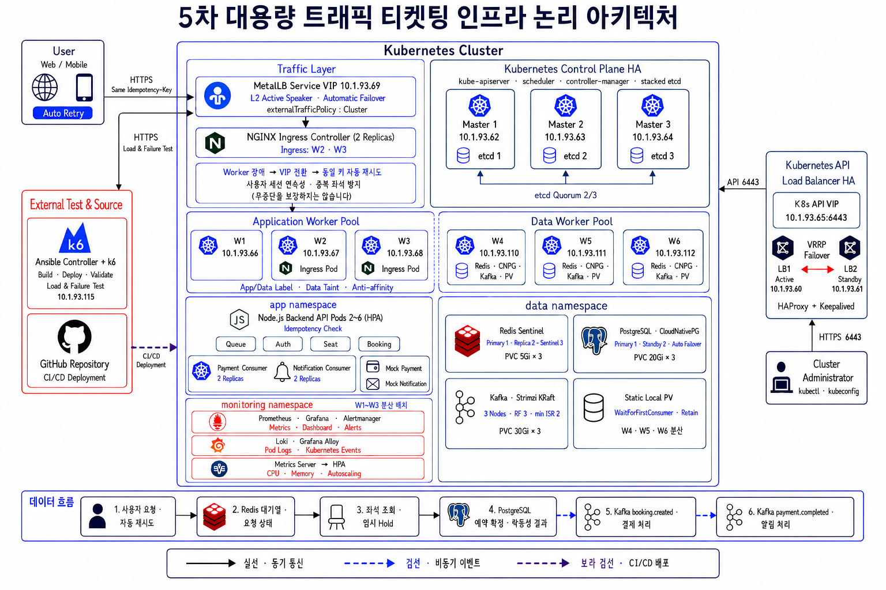

# Ticket Rail | Infrastructure Portfolio

온프레미스 Kubernetes 기반 티켓 예매 서비스를 **Hybrid Cloud 및 Full AWS 환경으로 확장**한 팀 프로젝트의 인프라 포트폴리오입니다.

이 저장소는 전체 팀 프로젝트 소스가 아니라, 제가 담당한 **Kubernetes 외부 트래픽 진입 구조·장애 검증**과 **AWS 네트워크·Terraform·Tailscale·ROSA 인프라**를 중심으로 선별한 자료입니다. 팀 공용 구성 및 팀 전체 검증 결과는 개인 담당 업무와 구분하여 표기했습니다.

> **운영 상태:** AWS 환경은 실제로 구축하고 검증한 뒤 프로젝트 종료 시 비용 관리를 위해 리소스를 정리했습니다. 저장소의 Terraform 코드는 현재 실행 중인 환경이 아니라 당시 구성과 검증 과정을 보여 주는 포트폴리오 자료입니다.

## 1. 프로젝트 개요

| 단계 | 환경 | 핵심 목표 |
| --- | --- | --- |
| 1차 | On-Premises Kubernetes | 외부 트래픽 진입 경로 구축 및 장애 상황의 서비스 연속성 검증 |
| 2차 · Hybrid | AWS VPC + Tailscale + ROSA HCP | 온프레미스 데이터 서비스를 유지하며 AWS 워크로드 연동 |
| 2차 · Full AWS | ROSA HCP + RDS + MSK + ElastiCache | AWS 관리형 데이터 서비스 전환 및 성능 검증 |
| 팀 통합 검증 | DR / E2E / 부하 테스트 | 장애 전환·복구 및 서비스 처리 성능 확인 |

## 2. 개인 담당 업무

### 2.1. 1차 프로젝트 — On-Premises

- Kubernetes 애플리케이션 Deployment 및 Service 구성
- MetalLB 설치 및 외부 VIP `10.1.93.69` 구성
- NGINX Ingress Controller 구축 및 2개 Pod 이중화
- Ingress 기반 외부 트래픽 라우팅과 HTTPS 접근 구성
- 외부 HTTPS 접근 및 Health Check 검증
- Ingress Controller Pod 장애 상황에서 서비스 지속 여부 검증
- Worker Node 장애 상황에서 서비스 지속 및 MetalLB VIP 이동 검증
- Kubernetes 구축·배포 과정에서 팀 공용 Ansible 자동화 자료 검토 및 활용

### 2.2. 2차 프로젝트 — Hybrid Cloud / Full AWS

- Terraform 기반 AWS VPC, Public/Private Subnet, Route Table, NAT Gateway 등 네트워크 인프라 구성
- 3개 Availability Zone을 고려한 네트워크 대역 및 라우팅 설계
- Tailscale Subnet Router 기반 온프레미스–AWS 사설 연결 구성 및 통신 경로 검증
- Private Test EC2 등을 활용한 라우팅·서비스 연결 문제 분석
- ROSA HCP 클러스터 구축을 위한 Terraform 인프라 구성 및 점검
- ROSA 워크로드와 온프레미스 데이터 서비스 간 연결 경로 검증
- Full AWS용 Amazon RDS PostgreSQL, Amazon MSK, ElastiCache Valkey 인프라 구성
- 서비스별 Security Group 및 Private Subnet 접근 정책 구성
- 인프라 구축·검증 과정 문서화와 프로젝트 종료 후 AWS 리소스 정리

> 애플리케이션 개발, CI/CD 구현 및 팀원이 수행한 작업을 개인 단독 성과로 표기하지 않았습니다.

## 3. 1차 아키텍처 — On-Premises Kubernetes

아래 이미지는 **1차 팀 프로젝트의 전체 인프라 아키텍처**입니다. 이 저장소에서는 전체 구성 중 제가 담당한 MetalLB, NGINX Ingress Controller, Kubernetes 애플리케이션 배포 및 장애 검증 영역을 중심으로 설명합니다.



### 외부 트래픽 흐름

```text
Client
  |
  | HTTPS
  v
MetalLB VIP (10.1.93.69)
  |
  v
NGINX Ingress Controller (2 Pods)
  |
  v
Ingress Rule
  |
  v
Backend Service
  |
  v
Backend Pods
```

**MetalLB**는 온프레미스 Kubernetes에서 `LoadBalancer` 타입 Service에 외부 VIP를 제공하기 위해 도입했습니다. L2 방식으로 VIP를 광고하여 클러스터 외부에서 Ingress Controller에 접근할 수 있도록 구성했습니다.

**NGINX Ingress Controller**는 개별 서비스를 각각 외부에 노출하는 대신 단일 진입 지점에서 Host/Path 규칙에 따라 HTTP/HTTPS 요청을 내부 Service로 전달하기 위해 사용했습니다. Controller Pod를 2개로 구성해 단일 Pod 장애에 대비했습니다.

**HTTPS**는 초기 HTTP 구성 이후 인증서 및 실제 접근 경로를 검토하여 적용했습니다. Ingress VIP를 통한 HTTPS 요청과 Health Check 응답을 확인했습니다.

### 1차 장애 검증

- **Ingress Controller Pod 장애:** 2개 중 1개 Pod를 제거한 뒤 외부 요청이 계속 처리되는지 확인했습니다.
- **Worker Node 장애:** 장애 상황에서도 외부 요청 처리와 MetalLB VIP 이동이 이루어지는지 확인했습니다.

당시 검증의 초점은 **서비스 연속성과 VIP 이동**이었으며, 복구 시간·실패 요청 수 등의 정량 지표는 별도 후속 측정 항목으로 구분했습니다.

## 4. 2차 아키텍처 — Hybrid Cloud

> **아키텍처 이미지 추가 예정:** 2차 아키텍처 다이어그램은 아직 확정되지 않아 현재 README에는 넣지 않았습니다. 확정 후 이 섹션에 이미지를 추가할 예정입니다.

### 구성 목적

기존 온프레미스 Kubernetes와 데이터 서비스를 유지하면서 AWS의 ROSA HCP 워크로드를 추가했습니다. **Tailscale Subnet Router 기반 사설 네트워크 연결**을 통해 AWS 워크로드가 온프레미스의 필요한 서비스에 접근하도록 구성했습니다.

### 네트워크 개념도

```text
On-Premises Kubernetes / Data Services
  |
  | LAN: 10.1.93.0/24
  v
On-Prem Tailscale Subnet Router
  |
  | Tailscale encrypted connection
  v
AWS Tailscale Router EC2
  |
  | VPC routing
  v
AWS VPC: 10.20.0.0/16
  |
  +-- Public Subnets
  |
  +-- Private Subnets
       |-- ROSA HCP Worker Nodes
       +-- Private Test EC2
```

| 항목 | 설계값 |
| --- | --- |
| AWS Region | `ap-northeast-2` (서울) |
| AWS VPC CIDR | `10.20.0.0/16` |
| On-Premises LAN | `10.1.93.0/24` |
| ROSA Pod CIDR | `10.128.0.0/14` |
| ROSA Service CIDR | `172.30.0.0/16` |
| AWS AZ | `ap-northeast-2a`, `2b`, `2c` |
| 사설 연결 | Tailscale Subnet Router 기반 Site-to-Site |
| 인프라 관리 | Terraform |

### 기술 선택 이유

- **Terraform:** VPC, Subnet, Route Table, Security Group 및 클러스터 관련 설정을 코드로 관리하고 변경 내역과 환경별 구성을 명확히 하기 위해 사용했습니다.
- **Tailscale:** 온프레미스와 AWS 사이에 사설 통신 경로를 구성하기 위해 사용했습니다. 프로젝트에서는 AWS 네이티브 Site-to-Site VPN 대신 Subnet Router 방식을 기본 연결 수단으로 선택했습니다.
- **ROSA HCP:** AWS에서 관리형 OpenShift 환경을 활용해 Kubernetes 기반 워크로드를 실행하고 클라우드 확장 구성을 검증하기 위해 사용했습니다.
- **Private Subnet / Security Group:** 내부 리소스의 외부 노출을 줄이고 필요한 서비스 통신만 허용하도록 설계했습니다.

## 5. 2차 아키텍처 — Full AWS

> **아키텍처 이미지 추가 예정:** Full AWS 아키텍처 다이어그램도 최종본이 확정되면 이 섹션에 추가할 예정입니다.

Hybrid Cloud 단계에서는 주요 데이터 서비스가 온프레미스에 있었습니다. Full AWS 단계에서는 ROSA HCP를 활용하면서 데이터 계층을 AWS 관리형 서비스로 구성해 서비스 연동과 성능을 검증했습니다.

| 계층 | 서비스 | 역할 |
| --- | --- | --- |
| 애플리케이션 | ROSA HCP | Kubernetes 기반 워크로드 실행 |
| 관계형 DB | Amazon RDS PostgreSQL | 서비스 데이터 저장 |
| 메시징 | Amazon MSK | Kafka 기반 비동기 이벤트 처리 |
| 인메모리 | Amazon ElastiCache Valkey | 캐시 및 인메모리 데이터 처리 |
| 네트워크 | Amazon VPC / Security Group | 사설 통신 및 접근 제어 |
| IaC | Terraform | 클라우드 인프라 구성 관리 |

Terraform 구성에는 RDS DB Subnet Group, MSK 클러스터, Valkey Replication Group 및 서비스별 Security Group 등이 포함됩니다. 데이터 서비스는 Private Subnet에 배치하고 ROSA Worker와 필요한 통신 경로를 설정했습니다.

> 저장소의 설정은 **프로젝트 실습 및 검증 목적**의 구성입니다. 실제 운영 환경에 적용하려면 백업·삭제 방지·가용성·보안 정책을 별도로 검토해야 합니다.

## 6. 구축 및 검증 결과

### 개인 담당 영역

- 1차 온프레미스 Ingress Controller Pod 장애 및 Worker Node 장애 검증
- AWS VPC 및 Private Subnet 기반 네트워크 구성
- Tailscale 라우팅과 온프레미스–AWS 통신 경로 검증
- ROSA 및 Full AWS 데이터 서비스 구성을 위한 Terraform 적용·점검
- 구축 후 연결 문제 분석, 설정 보완 및 AWS 리소스 정리

### 팀 프로젝트 통합 검증

- Hybrid Cloud 및 Full AWS 환경의 애플리케이션 연동 검증
- API 부하 및 비동기 예매·결제 End-to-End 테스트
- 성능 병목 분석 및 개선 결과 비교
- 온프레미스 장애 시 CloudWatch 경보와 Route 53 DNS Failover 기반 AWS DR 전환 검증
- DR 환경의 HTTPS 접속, 예매·결제·알림 처리 및 복구 후 Failback 검증

팀 전체 검증 결과는 개인이 단독 수행한 업무와 구분하여 정리했습니다.

## 7. 저장소 구조

```text
ticketing-infra/
├── kubernetes/                 # 1차 Kubernetes 구성
│   ├── app/                    # Deployment, Service, ConfigMap, HPA
│   ├── ingress/                # NGINX Ingress 관련 설정
│   └── metallb/                # MetalLB VIP 및 L2 설정
├── ansible/
│   └── team-reference/         # 팀 공용 Ansible 참고 자료
├── hybrid-cloud/               # 2차 프로젝트 구성
│   ├── terraform/              # AWS / ROSA Terraform 코드
│   └── monitoring/             # 모니터링 관련 구성
├── docs/
│   ├── images/
│   │   └── architecture.png    # 1차 아키텍처 이미지
│   ├── contribution.md
│   └── validation.md
├── .gitignore
└── README.md
```

### 코드 확인 포인트

- `kubernetes/metallb/`: 온프레미스 LoadBalancer VIP 구성
- `kubernetes/ingress/`: NGINX Ingress Controller 및 라우팅
- `kubernetes/app/`: Backend Deployment, Service, HPA 등
- `ansible/team-reference/`: 팀 공용 Kubernetes 자동화 참고 자료
- `hybrid-cloud/terraform/`: AWS 네트워크, Tailscale, ROSA, Full AWS 데이터 서비스 구성
- `hybrid-cloud/terraform/envs/full_cloud/`: RDS, MSK, Valkey 관련 Terraform 코드
- `hybrid-cloud/monitoring/`: 모니터링 관련 설정

## 8. 프로젝트를 통해 배운 점

1차 프로젝트에서는 `MetalLB → NGINX Ingress → Service → Pod`로 이어지는 외부 트래픽 경로를 직접 구성하고 장애 상황에서의 동작을 검증했습니다.

2차 프로젝트에서는 온프레미스와 AWS를 연결할 때 **VPC 라우팅, Subnet, 보안 정책, 서비스 노출 방식**을 함께 고려해야 한다는 점을 확인했습니다. Terraform을 사용해 인프라 설정을 코드로 관리하고, ROSA와 AWS 관리형 데이터 서비스까지 확장하면서 환경별 설계 차이를 학습했습니다.

특히 리소스를 생성하는 데 그치지 않고 **왜 해당 구성을 선택했는지, 어떤 경로로 통신하는지, 문제가 발생했을 때 어디서부터 검증해야 하는지**를 설명할 수 있도록 작업 과정을 기록했습니다.

## 9. 공개 범위 및 운영 상태

포트폴리오 공개본에서는 Secret, Private Key, `.env`, kubeconfig, Terraform State, 로그, 백업, 테스트 증적 원본 등 민감하거나 불필요한 자료를 제외했습니다. 팀 공용 자료와 개인 담당 업무를 구분했으며, CI/CD 관련 팀원 담당 구현을 개인 성과로 표기하지 않았습니다.

**AWS 실습 리소스는 구축·검증 후 삭제했습니다.** 실제 재구축이나 운영 환경에 적용하려면 IP, 도메인, 인증서, IAM 권한, 보안 및 데이터 보호 정책을 환경에 맞게 다시 검토해야 합니다.
